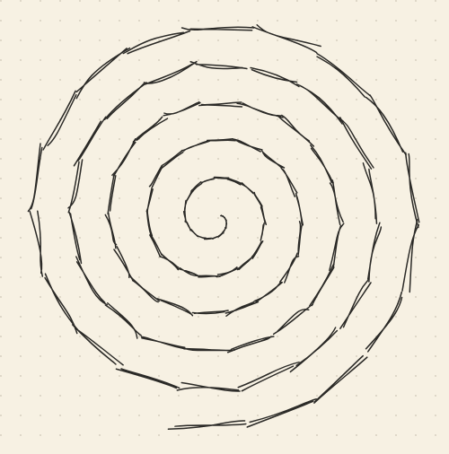
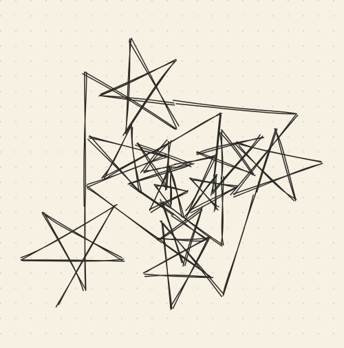
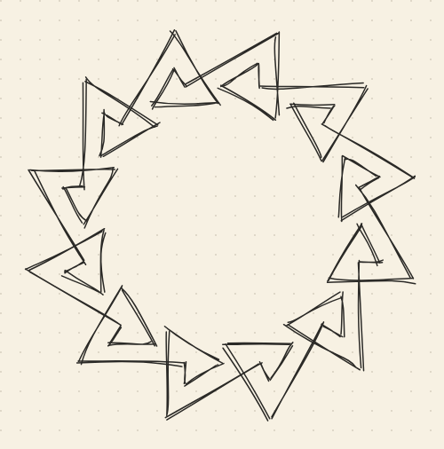
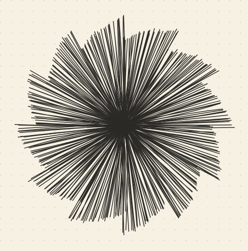
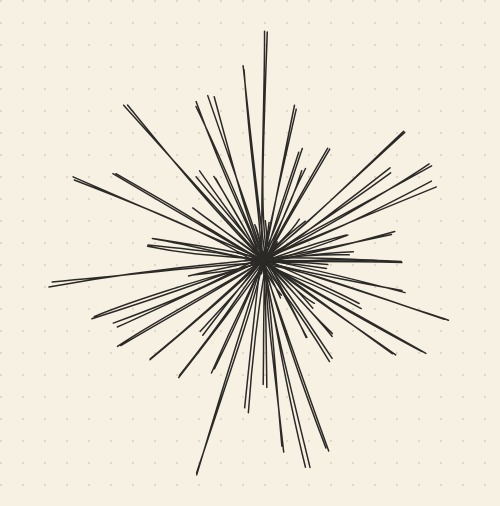

# Plumeto

This is a drawing application for [turtle graphics](https://en.wikipedia.org/wiki/Turtle_graphics) using a custom scripting language based on [LOGO](https://en.wikipedia.org/wiki/Logo_(programming_language)). Made in inspiration of a highschool project I lost the code of. It is also able to draw [L-systems](https://en.wikipedia.org/wiki/L-system).

## Plumeto language

Formal launguage definition can be found at `src/language/grammar.pegjs`. In a nutshell, it is a simple procedural language with a somewhat C-like syntax.

### Examples

See the `examples/` folder, grouped into `basics/`, `patterns/`, `golden-ratio/` and `l-systems/`.
|Script|Output|
|-|-|
|**weed(stochastic)**|.png)|
|**spiral**||
|**hexpiral**||
|**penta-doodle**||
|**saw**||
|**stick-saw**||
|**star**||

## Development

Plumeto is built with React and [Vite](https://vitejs.dev), [peggy](https://github.com/peggyjs/peggy) for parser generation and [roughjs](https://github.com/rough-stuff/rough) to draw on canvas in a sketchy style.

Install dependencies and run the development server:

```bash
pnpm install
pnpm dev
```

Open [http://localhost:5173](http://localhost:5173) with your browser to see the result.

The app lives in `src/App.tsx` and the language (grammar, AST types and interpreter) in `src/language/`. The page auto-updates as you edit.

If you make changes to the grammar in `src/language/grammar.pegjs` update the generated parser by running

```bash
pnpm grammar
```

`pnpm build` regenerates the parser and builds the site into `dist/`.

## Tests

```bash
pnpm test
```

Tests live in `tests/`, mirroring `src/`. `tests/language/examples.test.ts` fingerprints the drawing of every script in `examples/`. If a change to one is intended, update the snapshots with `pnpm test -u`.

## CLI

Render a `.plm` script to SVG from the command line:

```bash
node cli/bin.js examples/basics/spiral.plm            # outputs spiral.svg
node cli/bin.js examples/basics/spiral.plm -o out.svg
```

## Roadmap
- Language
  - Data structures (lists), mainly to make L-systems easier to write
  - Local variables: assignments inside a function are global today (by design), consider a way to keep them local
  - Allow continuing an expression on the next line after an operator
  - Allow line breaks inside command arguments, e.g. after the comma in `place x, y` (function calls already allow them)
  - A way to read the cursor's position and direction, so scripts don't have to track them in variables
  - A `pi` constant
  - Colors, e.g. a `color red` command (needs the interpreter, canvas and CLI to carry a color per line)
  - Other cool stuff
- UX
  - Let Stop interrupt a script that is still computing (e.g. an endless loop, which currently freezes the tab), by running the interpreter in a Web Worker
